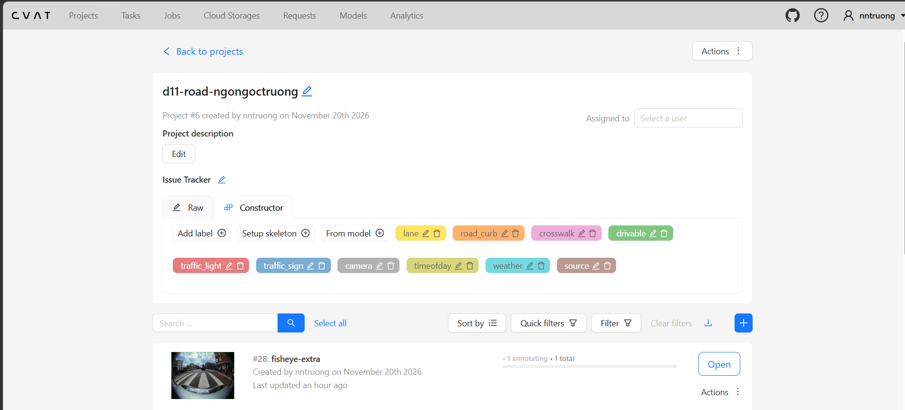
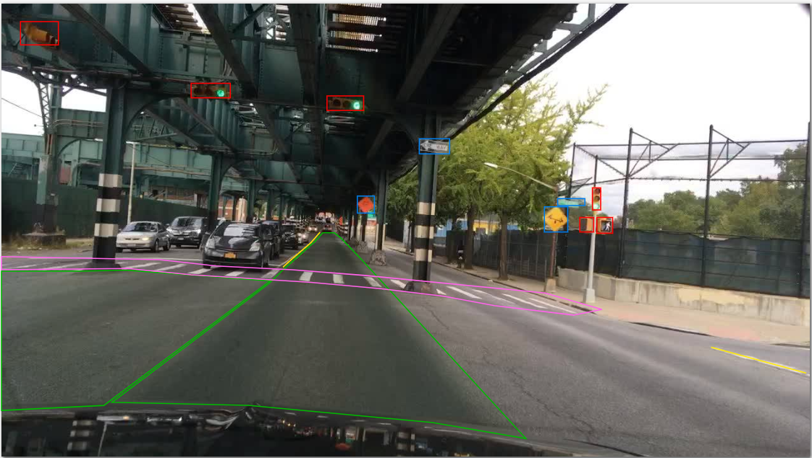
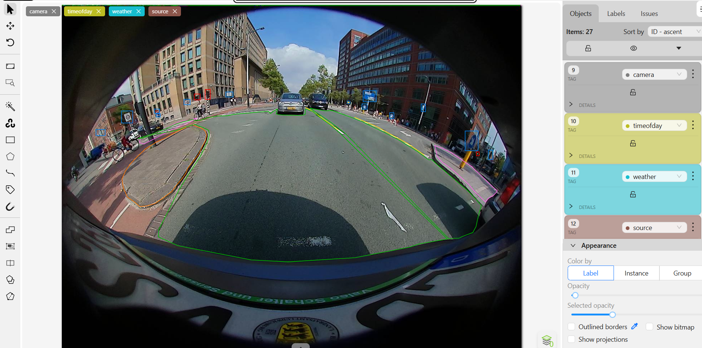
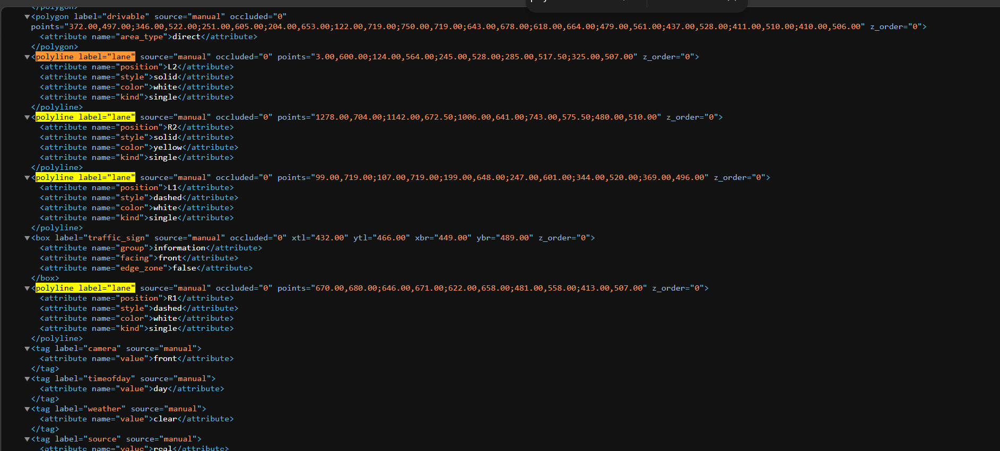

# Báo cáo cá nhân — Ngày 11
Họ tên: Ngô Ngọc Trường    Mã học viên: 2A202603329  
Phiên bản CVAT (Help → About): 2.74.1  
Guideline: Road v1.0    Lần nộp (`revision` trong manifest): 1  
Thời điểm export (ngày giờ trên CVAT): 2026-11-20 16:09 UTC (23:09 giờ Việt Nam)    Số lần nộp lại sau Rework: 0  

## 1. Kiểm project
| Mục | Đúng như guideline Road v1.0? | Ghi chú |
| --- | --- | --- |
| 6 label, đúng kiểu | Đúng | lane và road_curb là polyline; crosswalk và drivable là polygon; traffic_light và traffic_sign là rectangle. So với `python -m road_lab.taxonomy`: khớp. |
| Thuộc tính và giá trị | Đúng | lane: position, style, color, kind; drivable: area_type; traffic_light: color, type, facing, edge_zone; traffic_sign: group, facing, edge_zone. |
| 4 tag ảnh | Đúng | camera, timeofday, weather, source, mỗi tag có thuộc tính `value`. |
Cách kết thúc polyline trên bản CVAT này: click các điểm từ gần xe ra xa, bấm phím **N** để kết thúc.  
Cách đặt tag ảnh trên bản CVAT này: dùng công cụ Tag ở thanh bên trái, đặt camera trước rồi timeofday, weather, source; mở Details của từng tag để kiểm giá trị (CVAT tự điền giá trị đầu tiên của danh sách).

## 2. Số lượng đã gán
| Task | Ảnh | lane | road_curb | crosswalk | drivable | traffic_light | traffic_sign |
| --- | ---: | ---: | ---: | ---: | ---: | ---: | ---: |
| front | 12 | 27 | 1 | 6 | 25 | 27 | 32 |
| front-extra (đã làm 4 / 4) | 4 | 10 | 3 | 3 | 7 | 18 | 15 |
| fisheye | 8 | 12 | 4 | 15 | 11 | 11 | 16 |
| fisheye-extra (đã làm 4 / 4) | 4 | 2 | 5 | 6 | 2 | 2 | 0 |

(Tổng khớp với `shapes_by_label` trong manifest: front lane 37, fisheye lane 14, v.v.)

## 3. Bảng ca khó
| Ảnh | Nhãn | Phân vân giữa | Đã chọn | Lý do |
| --- | --- | --- | --- | --- |
| B10 | crosswalk | Vạch ngựa vằn lát gạch (không sơn trắng rõ) và mặt đường thường | Gán crosswalk một polygon quanh vùng vạch | Guideline: một polygon quanh toàn bộ vạch qua đường; gạch lát vẫn là chỗ người đi bộ băng qua. |
| B11 | drivable, lane | Gán vạch ô đỗ và vùng lái bên bãi đỗ; hay chỉ gán vạch dọc | Chỉ gán lane vạch dọc, bỏ vạch ô đỗ và không gán drivable | Vạch ô đỗ không phải lane; khu bãi đỗ không phải làn xe chạy. |
| B12 | drivable | Gồm hay loại làn xe đạp khỏi vùng lái | Loại làn xe đạp | Guideline loại làn xe đạp, vỉa hè, dải đỗ khỏi vùng lái. |
| A11, A12, B04, B06, B08, B12 | crosswalk và drivable | Khoét vạch qua đường ra khỏi drivable, hay cho hai polygon chồng nhau | Cho crosswalk nằm chồng lên drivable | Vạch qua đường nằm trên mặt đường lái được; chỉ cần drivable không phủ lên vạch kẻ làn. |
| A05, A07, A08, A09, A14 | lane | Vẽ thêm L1/R1 theo suy đoán, hay bỏ qua | Không vẽ | Không thấy vạch trong ảnh; vẽ theo suy đoán làm model học vạch không có thật. Lint báo QC1-02, đã ghi vào phiếu và sẽ hỏi coach xác nhận. |
| A06 | lane | Vẽ lane từ xa về gần hay gần ra xa | Vẽ gần ra xa | Quy tắc chiều vẽ; lint từng báo lane #14 ngược chiều, đã đảo lại. |
| B05, B07, B08 | lane | Gán L1/R1 hay other | position = other | Camera hai bên (MVL/MVR) không có khái niệm L1/R1 theo xe. |

## 4. Phiếu QC 1 nhận được
Bạn kiểm lô của tôi: dotrunghieu  Quyết định nhận được: (chưa nhận phiếu; điền sau khi bạn gửi)  
| Mã lỗi | Số lỗi | Đồng ý? | Đã sửa? |
| --- | ---: | --- | --- |
| (điền khi nhận được phiếu) |  |  |  |

## 5. Kiểm file export
| File | Mở lại được? | Số shape ảnh 1 (job / file) | Số shape ảnh 2 (job / file) | Tag camera có trong XML? |
| --- | --- | --- | --- | --- |
| ngongoctruong-front.zip | Có (lint đọc 16 ảnh) | A01: 9 / 9 | A02: 5 / 5 | Có, 16/16 ảnh |
| ngongoctruong-fisheye.zip | Có (lint đọc 12 ảnh) | B01: 2 / 2 | B02: 9 / 9 | Có, 12/12 ảnh |

Ghi chú: mỗi file zip chứa một `annotations.xml` gộp từ hai task (front + front-extra, fisheye + fisheye-extra). Lint không còn lỗi nặng ngoài 6 mục QC1-02 ở ảnh không thấy vạch (A05 L1/R1, A07 L1, A08 L1, A09 R1, A14 R1), chờ coach xác nhận.

## 6. Ảnh chụp màn hình
1. Tab Labels của project: 
2. Ảnh camera trước đã gán đủ (A06: làn, vùng lái, đèn, biển): 
3. Ảnh fisheye đã gán, polyline cong: 
4. Đoạn XML có `<polyline label="lane">`: 

## 7. Tự đánh giá
Lỗi bạn mắc nhiều nhất hôm nay (theo mã QC1-xx), và cách tránh ở Ngày 20: Nhiều nhất là QC1-03 và QC1-11: quên đặt `position = other` cho lane ở camera hai bên và để `edge_zone` sai ở fisheye. Kế đến là QC1-04 (lane vẽ ngược chiều ở A06) và QC1-07 (drivable phủ lên vạch kẻ làn). Cách tránh: trước khi export luôn chạy `road_check lint` và đối chiếu từng cảnh báo, đặt thuộc tính theo tên file (FV/RV/MVL/MVR) ngay khi mở ảnh, và vẽ lane luôn từ đáy ảnh lên.  
Nhãn của bạn đi vào model ở đâu? Chọn một lỗi đã sửa và nói nó làm model học sai thế nào: Lane và vùng lái là đích cho model phát hiện làn (ví dụ row-anchor). Nếu lane A06 vẽ từ xa về gần, các hàng y lấy x theo thứ tự ngược, model học sai chiều và điểm dừng; ở đoạn gần xe, quan trọng nhất cho giữ làn (LKA), đích bị lệch. Nếu drivable phủ lên vạch kẻ, model học vùng lái tràn sang vạch, làm xe tưởng được lấn làn.

## 8. (Tùy chọn, buffer) Từ polyline đến đích row-anchor
Không làm (tùy chọn, không chấm điểm).
